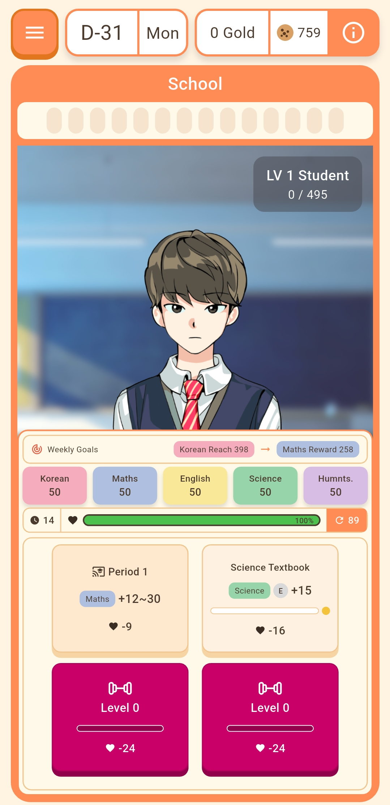
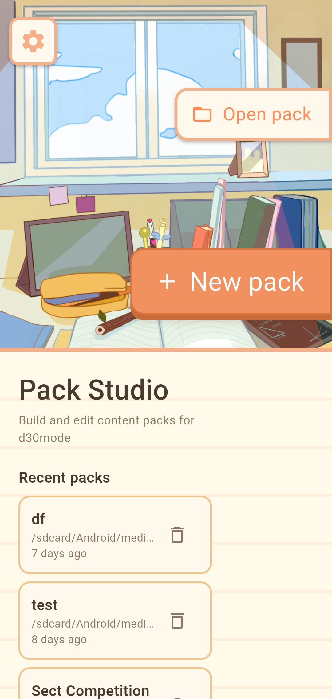

<h1>
<picture>
  <source media="(prefers-color-scheme: light) and (prefers-reduced-motion: reduce)" srcset="./beach-header-still.svg">
  <source media="(prefers-reduced-motion: reduce)" srcset="./particle-field-still.svg">
  <source media="(prefers-color-scheme: light)" srcset="./beach-header.svg">
  
</picture>
</h1>

I’m a Purdue CS student interested in algorithms and machine intelligence. I build tools for problems I run into, from planning classes to editing game content.

## Selected projects

###  [Brightspace Canvas Wrapper](https://github.com/rishabh-mohan/brightspace-canvas-wrapper) · Firefox extension

A Canvas-style dashboard for Brightspace with what-if grades and optional Gradescope and Ed Discussion integrations. It puts courses, assignments, grades, and the calendar in one interface.

View dashboard

###  [d31](https://github.com/rishabh-mohan/d31) +  [Pack Studio](https://github.com/rishabh-mohan/pack-studio) · Game engine and editor

d31 is a clean-room Dart and Flutter rebuild of Korean Student Simulator’s 31-Day Mode. The engine reads the calendar, locations, items, and branching events from JSON packs, so a new campaign can run without changes to the engine. Pack Studio is the Android editor for those packs and validates them with the game engine.

View d31 and Pack Studio

  
  

d31 gameplay and the Pack Studio home screen.

###  [rr-scraper](https://github.com/rishabh-mohan/rr-scraper) · Node.js CLI

Search Royal Road by title or paste a novel URL, then export chapters as TXT, PDF, or EPUB.

<picture>
  <source media="(prefers-reduced-motion: reduce)" srcset="./rr-scraper-demo-still.svg">
  
</picture>

## Experiments

- **Purdue Course Request Planner** — A browser extension prototype that previews weekly schedules, flags overlaps, and compares alternatives by start time, gap length, and how many days you’d be on campus.
- **`gemini-api`** — A personal command-line tool for sending prompts to Gemini and capturing responses for local workflows.

[More on GitHub →](https://github.com/rishabh-mohan?tab=repositories)

<picture>
  <source media="(prefers-color-scheme: light) and (prefers-reduced-motion: reduce)" srcset="./day-ridge-still.svg">
  <source media="(prefers-reduced-motion: reduce)" srcset="./night-ridge-still.svg">
  <source media="(prefers-color-scheme: light)" srcset="./day-ridge.svg">
  
</picture>
